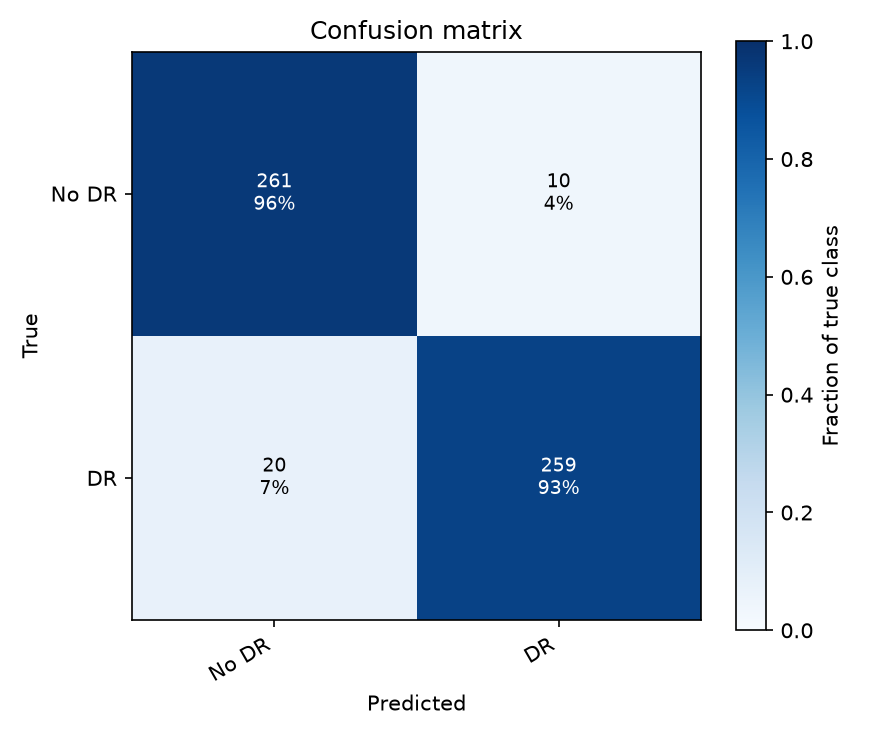
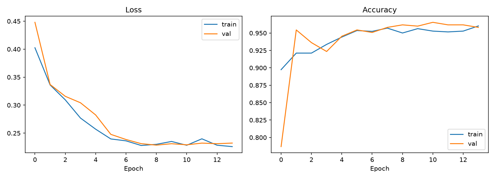
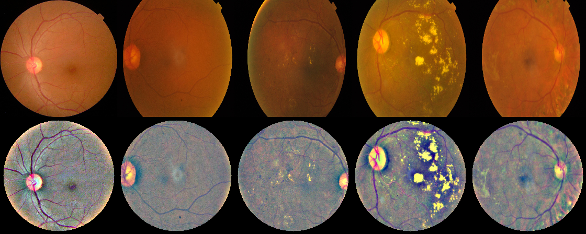

# Diabetic Retinopathy Screening (CNN + Transfer Learning)

A CNN classifier that detects diabetic retinopathy (DR) in retinal fundus images.
It uses TensorFlow/Keras, NumPy, pandas and OpenCV.

| Task 5 learning outcome | Where it is covered |
|---|---|
| Image preprocessing | [src/preprocess.py](src/preprocess.py): crops the black border, resizes, applies Ben Graham's lighting normalisation and a circular mask (OpenCV) |
| Transfer learning | [src/model.py](src/model.py), [train.py](train.py): an ImageNet backbone (EfficientNetB0, ResNet50V2 or DenseNet121) trained in two phases (frozen backbone, then fine-tuning) |
| Model evaluation | [src/evaluation.py](src/evaluation.py), [evaluate.py](evaluate.py): confusion matrix, F1 (macro and weighted), per-class report, ROC-AUC, sensitivity and specificity, quadratic weighted kappa |

There are two modes:
- `--mode binary` (the default) is a screening model: **No DR** vs **DR** (grade ≥ 1).
- `--mode multiclass` predicts all 5 severity grades: No DR, Mild, Moderate, Severe, Proliferative.

## Results (binary screening, EfficientNetB0, APTOS 2019)
These results are on the held-out test set of 550 images. The model never saw them during training or model selection.

| Metric | Value |
|---|---|
| Accuracy | 0.945 |
| F1 (macro) | 0.945 |
| ROC-AUC | 0.984 |
| Sensitivity (DR caught) | 0.928 |
| Specificity (healthy cleared) | 0.963 |

| Confusion matrix | Training curves |
|---|---|
|  |  |

Preprocessing, raw images (top) vs enhanced (bottom), grades 0–4:


Full report: [results/metrics_test.txt](results/metrics_test.txt)

## Project layout
```
Diabetic/
├── src/
│   ├── config.py          paths and hyper-parameters
│   ├── preprocess.py      OpenCV fundus preprocessing
│   ├── data.py            CSV loading, stratified split, class weights, tf.data + augmentation
│   ├── model.py           transfer-learning model, freeze/unfreeze helpers
│   └── evaluation.py      metrics and plots
├── prepare_data.py        preprocess raw images once and cache them as PNGs
├── train.py               two-phase training, then evaluation on the test set
├── evaluate.py            evaluate a saved run (confusion matrix, F1, ...)
├── predict.py             classify new fundus images
├── scripts/make_synthetic_data.py   fake dataset for smoke-testing
└── requirements.txt
```

## 1. Setup
```powershell
python -m venv .venv
.\.venv\Scripts\activate
pip install -r requirements.txt
```

## 2. Get the dataset
**Easiest, no account needed:** download all 3,662 labelled APTOS images (already resized to 224×224) from Hugging Face.
```powershell
python scripts/download_dataset.py     # ~250 MB -> data/train.csv + data/train_images/
```

**Or download from Kaggle:** use the **APTOS 2019 Blindness Detection** dataset there:
https://www.kaggle.com/competitions/aptos2019-blindness-detection/data
It has 3,662 labelled images graded 0–4. You need a Kaggle account and must accept the competition rules.

```powershell
# option A: Kaggle CLI (needs kaggle.json API token in %USERPROFILE%\.kaggle)
pip install kaggle
kaggle competitions download -c aptos2019-blindness-detection -p data
Expand-Archive data\aptos2019-blindness-detection.zip -DestinationPath data
# option B: download the zip in the browser and extract it into data\
```
You should end up with `data/train.csv` (columns `id_code, diagnosis`) and `data/train_images/*.png`.
Any other dataset with the same CSV and image layout also works, for example EyePACS or Messidor converted to it.

## 3. Preprocess (run once)
```powershell
python prepare_data.py            # writes data/processed/*.png at 224x224
```

## 4. Train
```powershell
python train.py --mode binary                       # screening model
python train.py --mode multiclass                   # 5-grade model
python train.py --mode binary --backbone densenet121
```
Each run writes to `outputs/<mode>_<backbone>/`:
`model.keras`, `train/val/test.csv`, `history.csv`, `training_curves.png`,
`metrics_test.txt`, `confusion_matrix_test.png`, `roc_test.png` (binary mode), `predictions_test.csv`.

On CPU, one epoch over APTOS takes several minutes. A GPU or Google Colab is much faster.
To check that everything works first, run a short job with `--head-epochs 2 --fine-tune-epochs 2`.

## 5. Evaluate and predict
```powershell
python evaluate.py --run outputs/binary_efficientnetb0
python predict.py  --run outputs/binary_efficientnetb0 data\train_images\000c1434d8d7.png
```

## Smoke test without the real dataset
```powershell
python scripts/make_synthetic_data.py --n 300 --out data/synthetic
python prepare_data.py --csv data/synthetic/train.csv --images data/synthetic/train_images --out data/synthetic/processed
python train.py --csv data/synthetic/train.csv --images data/synthetic/processed --out outputs/smoke --head-epochs 3 --fine-tune-epochs 2
```
The synthetic images are not medical data. They only show that the pipeline runs end to end.

## Design notes
- **Class imbalance:** APTOS is about 49% grade 0 and has few Severe cases. Balanced `class_weight` and macro-F1 stop the model from just predicting the majority class.
- **Split:** the data is split 70/15/15 with stratification. The test set is saved to `test.csv` and is only used after training.
- **Fine-tuning:** BatchNorm layers stay frozen while the top layers are fine-tuned at learning rate 1e-5, so the pretrained statistics are not destroyed by small batches.
- **Screening metrics:** for screening, *sensitivity* (the share of DR cases caught) matters most. You can lower the decision threshold on `p_DR` in `predictions_test.csv` to trade specificity for sensitivity.

> This is an educational project, not a medical device.
